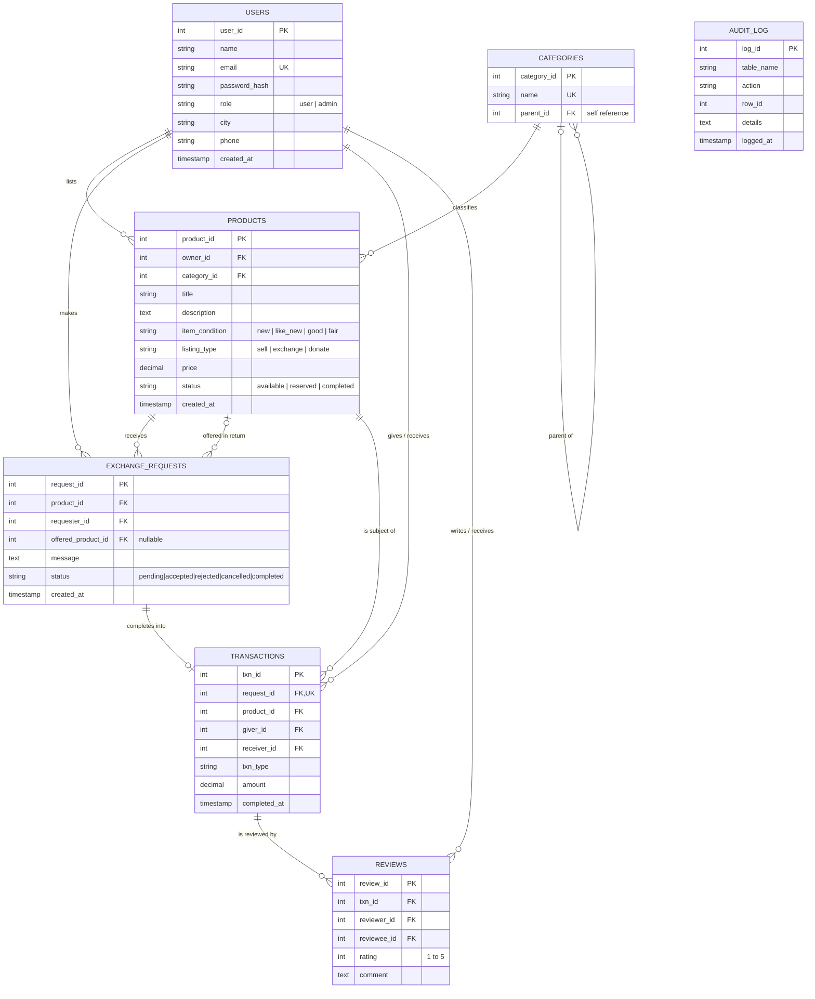

# ER Diagram (rubric: ER diagram — 2 marks)

Renders automatically on GitHub. To get a PNG/PDF for your report, paste the block into <https://mermaid.live> and export.



## MongoDB document (NoSQL side)

Collection `product_details` — one document per product, linked by `product_id`:

```json
{
  "product_id": 5,
  "tags": ["laptop", "student"],
  "attributes": { "brand": "Dell", "ram_gb": 8, "storage": "256GB SSD" },
  "images": [],
  "pickup": { "city": "Mumbai", "availability": ["weekends"] },
  "impact": { "co2_saved_kg": 40, "waste_diverted_kg": 2.2 },
  "notes": [ { "_id": "…", "by_user_id": 4, "by_name": "Ravi", "text": "Can I test it?", "at": "…" } ],
  "created_at": "…", "updated_at": "…"
}
```
